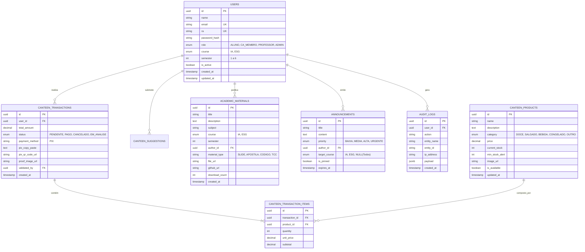

# DIAGRAMA ENTIDADE-RELACIONAMENTO (DER) E DICIONÁRIO DE DADOS
**Projeto:** Portal Integrado FATEC Rio Claro  
**Disciplina:** Estágio Curricular Supervisionado (Prof. Orlando)  
**Engenheiro Responsável:** Cesar (Backend, Banco de Dados & Segurança)  
**Status:** Sprint 1 Concluída  

---

## 1. Visão Geral da Modelagem

O modelo de dados foi concebido em PostgreSQL para garantir conformidade **ACID**, velocidade nas transações da cantina discente (*Honest Market*), auditoria integral de acessos e suporte nativo a indexação para buscas no repositório acadêmico.

### Diagrama Entidade-Relacionamento (Mermaid)

---

## 2. Dicionário de Dados e Regras de Integridade

### A. Tabela `users`
* `id` (UUID): Identificador único imutável gerado por `gen_random_uuid()`.
* `password_hash` (VARCHAR): Hash gerado via **bcrypt** com 10 a 12 salt rounds. Nenhuma senha trafega ou é salva em texto plano.
* `role` (ENUM): Define o controle de acesso baseado em funções (RBAC). Permissões:
  * `ALUNO`: Consulta catálogo, realiza compras, acessa repositório, baixa materiais.
  * `CA_MEMBRO`: Gestão de estoque da cantina, conferência de comprovantes Pix, emissão de avisos discentes.
  * `PROFESSOR`: Curadoria de materiais, envio de notas de aula e avisos acadêmicos.
  * `ADMIN`: Acesso irrestrito e visualização de auditoria.

### B. Módulo Cantina (`canteen_products`, `canteen_transactions`, `canteen_transaction_items`)
* **Integridade de Estoque:** `current_stock` possui restrição `CHECK (current_stock >= 0)`.
* **Rastreabilidade de Compras:** Ao realizar um pedido no Honest Market, cria-se uma transação `PENDENTE` vinculada ao usuário autenticado com chave Pix dinâmica contendo o valor exato. Quando o pagamento é validado (via IA OCR ou CA), o status é alterado para `PAGO`.

### C. Segurança & Auditoria (`audit_logs`)
* Todas as operações sensíveis (login, alteração de privilégios, baixa de estoque manual e aprovação de transação) registram um evento em `audit_logs` contendo IP, Agente do Usuário e Payload das modificações.
