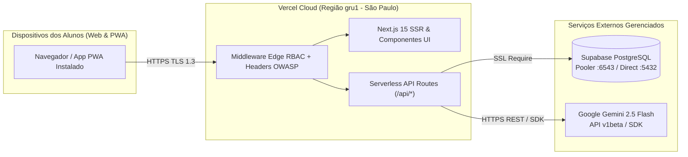

# GUIA DE DEVOPS: HOSPEDAGEM EM NUVEM (VERCEL & SUPABASE) E INTEGRAÇÃO GOOGLE GEMINI SDK
**Projeto:** Portal Integrado dos Estudantes da FATEC Rio Claro  
**Disciplina:** Estágio Curricular Supervisionado (Prof. Orlando)  
**Engenheiro Responsável:** Guilherme (Inteligência Artificial, DevOps & QA)  
**Data:** Sprint 1 (Outubro / Novembro de 2026)  

---

## 1. ARQUITETURA DE IMPLANTAÇÃO E CLOUD DEVOPS

A infraestrutura de nuvem do **Portal Integrado FATEC Rio Claro** foi desenhada para operar com **alta disponibilidade, latência reduzida no Brasil (`sa-east-1` / `gru1`) e custo zero de manutenção** para o Centro Acadêmico e a instituição, combinando:
* **Vercel (Edge & Serverless Application Platform):** Hospedagem nativa do Next.js 15 (App Router), distribuição global de assets estáticos e PWA via CDN, certificados TLS/SSL automáticos e execução isolada dos Route Handlers (`/api/*`).
* **Supabase Cloud (Managed PostgreSQL 16 + Connection Pooler):** Banco de dados relacional gerenciado na região Sul da América (São Paulo), com *Supavisor Connection Pooler* (porta `6543`) para evitar exaustão de conexões em funções Serverless, e conexão direta (porta `5432`) para execução dos scripts `migrate.js` e `seed.js`.
* **Google AI Studio / Gemini SDK (`gemini-2.5-flash`):** Motor multimodal de baixa latência para pré-validação automatizada de comprovantes Pix (OCR da Cantina *Honest Market*) e assistência acadêmica aos alunos de IA e Gestão ESG.



---

## 2. PASSO A PASSO: CONFIGURAÇÃO DO SUPABASE (BANCO DE DADOS)

1. **Criação do Projeto no Supabase:**
   * Acesse [database.new](https://database.new) na organização da equipe.
   * **Nome do Projeto:** `portal-fatec-rio-claro`
   * **Região:** `South America (São Paulo) - sa-east-1` (garante latência < 15ms junto à Vercel `gru1`).
   * Guarde a senha mestre do banco PostgreSQL gerada com alta entropia.

2. **Coleta das Strings de Conexão (`Project Settings > Database`):**
   * **Transaction Pooler (Porta `6543`):** Copie a URI com `?pgbouncer=true&sslmode=require` e atribua à variável `DATABASE_URL`.
   * **Session / Direct Connection (Porta `5432`):** Copie a URI direta e atribua à variável `DIRECT_URL`.

3. **Coleta das Chaves de API (`Project Settings > API`):**
   * Copie a `Project URL` para `NEXT_PUBLIC_SUPABASE_URL`.
   * Copie a chave pública `anon public` para `NEXT_PUBLIC_SUPABASE_ANON_KEY`.
   * Copie a chave administrativa `service_role` (apenas backend) para `SUPABASE_SERVICE_ROLE_KEY`.

4. **Execução das Migrations e Carga Inicial (Seed):**
   * Com a variável `DATABASE_URL` apontando para o Supabase e `USE_MOCK_DB=false`:
     ```bash
     npm run db:migrate
     npm run db:seed
     ```
   * Verifique no *Table Editor* do Supabase a criação das 8 tabelas (`users`, `canteen_products`, `canteen_transactions`, `canteen_transaction_items`, `canteen_suggestions`, `academic_materials`, `announcements`, `audit_logs`).

---

## 3. PASSO A PASSO: CONFIGURAÇÃO DA VERCEL (HOSPEDAGEM)

1. **Importação do Repositório GitHub:**
   * No painel da Vercel, selecione **Add New... > Project** e importe o repositório `Estagio-Fatec`.
   * **Framework Preset:** `Next.js` (detectado automaticamente via [`vercel.json`](file:///C:/Users/guilh/Downloads/Estagio-Fatec-main/Estagio-Fatec-main/vercel.json)).
   * **Root Directory:** `./` (ou `Estagio-Fatec-main` caso o repositório contenha subpasta).

2. **Matriz de Variáveis de Ambiente na Vercel (`Settings > Environment Variables`):**

| Variável | Escopo na Vercel | Descrição / Valor de Referência | Sensível? |
| :--- | :---: | :--- | :---: |
| `NODE_ENV` | Production / Preview | `production` | Não |
| `NEXT_PUBLIC_APP_URL` | Production | `https://portal-fatec-rc.vercel.app` | Não |
| `JWT_SECRET` | Todos | Chave aleatória HMAC-SHA256 com >= 32 bytes (`openssl rand -hex 32`) | **Sim** |
| `JWT_EXPIRES_IN` | Todos | `7d` | Não |
| `DATABASE_URL` | Production / Preview | URI Supabase Pooler (`:6543/postgres?pgbouncer=true&sslmode=require`) | **Sim** |
| `DIRECT_URL` | Production / Preview | URI Supabase Direta (`:5432/postgres?sslmode=require`) | **Sim** |
| `NEXT_PUBLIC_SUPABASE_URL` | Todos | `https://[PROJECT_REF].supabase.co` | Não |
| `NEXT_PUBLIC_SUPABASE_ANON_KEY` | Todos | Token JWT `anon` público do Supabase | Não |
| `SUPABASE_SERVICE_ROLE_KEY` | Production | Token JWT `service_role` restrito ao servidor | **Sim** |
| `USE_MOCK_DB` | Production / Preview | `false` em Produção (`true` apenas em desenvolvimento offline/CI) | Não |
| `GEMINI_API_KEY` | Todos | Chave gerada no Google AI Studio (`AIzaSy...`) | **Sim** |
| `GEMINI_MODEL` | Todos | `gemini-2.5-flash` | Não |
| `USE_MOCK_AI` | Production / Preview | `false` quando `GEMINI_API_KEY` ativa (`true` em testes locais/CI) | Não |
| `PIX_KEY` | Todos | `cantina.fatec.rc@fatec.sp.gov.br` | Não |
| `PIX_BENEFICIARY_NAME` | Todos | `Centro Academico Fatec Rio Claro` | Não |
| `PIX_CITY` | Todos | `RIO CLARO` | Não |

---

## 4. CONFIGURAÇÃO E TESTE DO SDK GOOGLE GEMINI

### 4.1. Emissão da Chave de API
1. Acesse o [Google AI Studio](https://aistudio.google.com/app/apikey) utilizando a conta Google dedicada ao projeto.
2. Clique em **Create API Key**, selecione o projeto de nuvem do portal e copie a chave iniciada em `AIza...`.
3. No ambiente local (`.env.local`), defina:
   ```env
   GEMINI_API_KEY=AIzaSySuaChaveRealAqui
   GEMINI_MODEL=gemini-2.5-flash
   USE_MOCK_AI=false
   ```
   *(Para desenvolvimento offline ou execução em esteira CI sem consumo de cota externa, mantenha `USE_MOCK_AI=true`).*

### 4.2. Execução do Teste de Conectividade
* **Via Terminal (Script Automatizado):**
  ```bash
  npm run test:ai
  ```
* **Via Endpoint HTTP (Com o servidor rodando):**
  * `GET http://localhost:3000/api/ai/health` — Retorna status da conexão, modo (`LIVE_GEMINI_API` ou `HYBRID_MOCK_AI`), modelo ativo e latência em milissegundos.
  * `POST http://localhost:3000/api/ai/health` — Recebe `{ "ocrRawText": "...", "expectedAmount": 11.50 }` e retorna o parecer estruturado de validação de comprovante Pix.

---

## 5. ESTEIRA DE TESTES AUTOMATIZADOS (QA PIPELINE)

A estratégia de Qualidade de Software (QA) combina três camadas complementares:

1. **Testes Unitários e de Contratos (Vitest — [`vitest.config.ts`](file:///C:/Users/guilh/Downloads/Estagio-Fatec-main/Estagio-Fatec-main/vitest.config.ts)):**
   * Valida criptografia Bcrypt, emissão/verificação de JWT (`jose`), Rate Limiting por IP, sanitização XSS e motor de IA Gemini ([`tests/unit/`](file:///C:/Users/guilh/Downloads/Estagio-Fatec-main/Estagio-Fatec-main/tests/unit/)).
   * Comando: `npm run test:unit`
2. **Testes End-to-End Multiplataforma (Playwright — [`playwright.config.ts`](file:///C:/Users/guilh/Downloads/Estagio-Fatec-main/Estagio-Fatec-main/playwright.config.ts)):**
   * Simula a jornada real do estudante em **Desktop Chrome** e **Mobile Android PWA (Pixel 7)**, validando o carregamento da Home sem *Cumulative Layout Shift*, manifesto PWA e respostas dos endpoints `/api/health` e `/api/ai/health` ([`tests/e2e/portal.spec.ts`](file:///C:/Users/guilh/Downloads/Estagio-Fatec-main/Estagio-Fatec-main/tests/e2e/portal.spec.ts)).
   * Comando: `npm run test:e2e`
3. **Suite Integrada de Regressão e Auditoria DevOps (Node Nativo — [`scripts/test_qa_pipeline.js`](file:///C:/Users/guilh/Downloads/Estagio-Fatec-main/Estagio-Fatec-main/scripts/test_qa_pipeline.js)):**
   * Executa instantaneamente sem dependências externas pesadas, auditando arquivos de configuração, segurança, rotas e IA.
   * Comandos: `npm test` ou `npm run test:qa`
