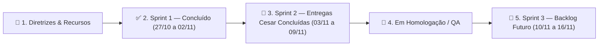

# QUADRO TRELLO OFICIAL DA EQUIPE — GESTÃO ÁGIL (SCRUM / KANBAN)
**Projeto:** Portal Integrado dos Estudantes da FATEC Rio Claro  
**Disciplina:** Estágio Curricular Supervisionado (Prof. Orlando)  
**Gestor de Qualidade, Requisitos & Agile Master:** Guilherme (DevOps, IA & QA)  
**Integrantes da Equipe (200h cada / 3 Sprints):**
* 👨‍💻 **Cesar** — Arquitetura Backend, Banco de Dados PostgreSQL & Segurança da Informação
* 🎨 **Luis** — Engenharia Frontend, UI/UX Design Simbiótico (IA/ESG), Acessibilidade & PWA
* 🤖 **Guilherme** — Infraestrutura DevOps (Vercel/Supabase), Inteligência Artificial (Google Gemini SDK), QA & Engenharia de Requisitos

---

## 1. ESTRUTURA DE ETIQUETAS (LABELS DO TRELLO)

| Cor da Etiqueta | Nome da Etiqueta | Escopo / Responsável Principal |
| :--- | :--- | :--- |
| 🔵 **Azul Escuro** | `[BACKEND & DB]` | APIs REST, PostgreSQL, Modelagem DER e Migrations (**Cesar**) |
| 🔴 **Vermelho** | `[SEGURANÇA OWASP]` | Bcrypt, JWT HttpOnly, RBAC, Rate Limiting e Auditoria (**Cesar**) |
| 🟢 **Verde Esmeralda** | `[FRONTEND & UI/UX]` | Design System Eco-Tech, Zero CLS, Acessibilidade e PWA (**Luis**) |
| 🟣 **Roxo** | `[IA & GEMINI SDK]` | Integração Google Gemini, OCR de Comprovantes Pix e Resumos (**Guilherme**) |
| 🟠 **Laranja** | `[DEVOPS & CLOUD]` | Hospedagem Vercel, Supabase Cloud, `.env` e CI/CD GitHub Actions (**Guilherme**) |
| 🟡 **Amarelo** | `[QA & REQUISITOS]` | Vitest, Playwright E2E, Especificação ERS e Gestão Trello (**Guilherme**) |

---

## 2. VISÃO PANORÂMICA DO KANBAN (RAIAS DO QUADRO TRELLO)

---

## 3. DETALHAMENTO DOS CARTÕES POR COLUNA (LISTAS DO TRELLO)

### 📌 COLUNA 1: DIRETRIZES DO PROJETO & DOCUMENTAÇÃO BASE
* **Card #00 — Visão do Produto & Pesquisa com 38 Alunos (IA + ESG)**
  * **Membros:** `@cesar`, `@luis`, `@guilherme`
  * **Descrição:** Centralizar resultados do formulário discente (38 respostas), unindo as turmas de IA (Matutino) e Gestão ESG (Noturno).
  * **Anexos Vinculados:** [`docs/especificacao_requisitos.md`](file:///c:/Users/fmsar/OneDrive/Documentos/GitHub/jogo_damas/Estagio-Fatec/docs/especificacao_requisitos.md), [`database/der.md`](file:///c:/Users/fmsar/OneDrive/Documentos/GitHub/jogo_damas/Estagio-Fatec/database/der.md), [`docs/arquitetura_seguranca.md`](file:///c:/Users/fmsar/OneDrive/Documentos/GitHub/jogo_damas/Estagio-Fatec/docs/arquitetura_seguranca.md) e [`docs/devops_vercel_supabase.md`](file:///c:/Users/fmsar/OneDrive/Documentos/GitHub/jogo_damas/Estagio-Fatec/docs/devops_vercel_supabase.md).

---

### ✅ COLUNA 2: SPRINT 1 — CONCLUÍDO (27/10 A 02/11/2026 — 66H POR INTEGRANTE)

#### 🔹 Entregas de DevOps, IA & QA — **Guilherme (66h)**
* **Card #G1 — Configurar Ambiente de Hospedagem e Variáveis na Vercel e Supabase** `[DEVOPS & CLOUD]` `(16h)` — ✅ Concluído
* **Card #G2 — Configurar Chaves de API e Testar Conectividade com o SDK do Google Gemini** `[IA & GEMINI SDK]` `(18h)` — ✅ Concluído
* **Card #G3 — Definir a Esteira de Testes Automatizados (Vitest / Playwright)** `[QA & REQUISITOS]` `(16h)` — ✅ Concluído
* **Card #G4 — Elaborar Documento de Especificação de Requisitos e Quadro Trello da Equipe** `[QA & REQUISITOS]` `(16h)` — ✅ Concluído

#### 🔹 Entregas de Backend, Banco de Dados & Segurança — **Cesar (66h)**
* **Card #C1 — Modelagem Relacional (DER) e DDL PostgreSQL (8 Tabelas)** `[BACKEND & DB]` `(28h)` — ✅ Concluído (`database/der.md`, `database/schema.sql`, `database/seed.sql`)
* **Card #C2 — Motor de Autenticação Bcrypt, JWT (`jose`) e RBAC Middleware** `[SEGURANÇA OWASP]` `(24h)` — ✅ Concluído (`src/lib/auth.ts`, `src/lib/security.ts`, `src/middleware.ts`)
* **Card #C3 — Endpoints REST de Autenticação, Health Check e Testes de Segurança** `[BACKEND & DB]` `(14h)` — ✅ Concluído (`src/app/api/auth/*`, `src/app/api/health/route.ts`, `scripts/test_backend.js`)

#### 🔹 Entregas de Frontend, UI/UX, Acessibilidade & PWA — **Luis (66h)**
* **Card #L1 — Pesquisa de UX, Identidade Visual FATEC/CPS e Mascote Galo Widget** `[FRONTEND & UI/UX]` `(22h)` — ✅ Concluído
* **Card #L2 — Design System Simbiótico (IA/ESG), Fundo Toroidal Canvas e Zero CLS** `[FRONTEND & UI/UX]` `(20h)` — ✅ Concluído
* **Card #L3 — Layout Multiplataforma PWA, Login, Cadastro e Rotas Acadêmicas** `[FRONTEND & UI/UX]` `(24h)` — ✅ Concluído

---

### 🚀 COLUNA 3: SPRINT 2 — EM EXECUÇÃO / HOMOLOGAÇÃO (03/11 A 09/11/2026 — 67H POR INTEGRANTE)

#### 🔹 Entregas de Backend, Banco de Dados & Segurança — **Cesar (67h / Total: 133h)**
* **Card #S2-C1 — Endpoints CRUD do Catálogo da Cantina e Controle de Estoque** `[BACKEND & DB]` `(20h)` — ✅ Concluído
  - [x] Endpoint `GET /api/canteen/products`: listagem com filtros por categoria e busca textual.
  - [x] Endpoint `POST /api/canteen/products`: cadastro restrito a membros do CA e Administradores (`CA_MEMBRO`/`ADMIN`).
  - [x] Endpoint `GET/PUT/DELETE /api/canteen/products/[id]`: consulta, atualização cadastral e exclusão lógica/física.
  - [x] Endpoint `PATCH /api/canteen/products/[id]/stock`: ajuste e reposição de estoque com verificação de não-negatividade e alertas de estoque mínimo (`min_stock_alert`).

* **Card #S2-C2 — Motor de Pix Dinâmico EMV Padrão Banco Central e Checkout da Cantina** `[BACKEND & SEGURANÇA]` `(20h)` — ✅ Concluído
  - [x] Serviço `src/lib/pix.ts`: codificação TLV (Tags 00 a 63), cálculo do checksum CRC-16/CCITT-FALSE (polinômio 0x1021, init 0xFFFF) e geração de `txid` único.
  - [x] Validador `validatePixPayload` com decodificação e auditoria reversa de integridade.
  - [x] Endpoint `POST /api/canteen/checkout`: criação do pedido, cálculo monetário exato, geração do payload Pix Copia-e-Cola e baixa de estoque atômica (ACID).
  - [x] Endpoints utilitários `POST /api/pix/generate` e `POST /api/pix/validate`.

* **Card #S2-C3 — API de Histórico e Extrato de Compras do Aluno** `[BACKEND & DB]` `(14h)` — ✅ Concluído
  - [x] Endpoint `GET /api/canteen/history`: extrato financeiro pessoal consolidado com total gasto, status e itens de cada compra.
  - [x] Endpoint `GET /api/canteen/transactions`: listagem auditada de pedidos para o discente e visão gerencial para o Centro Acadêmico.
  - [x] Endpoint `GET/PATCH /api/canteen/transactions/[id]`: consulta detalhada e atualização de status.
  - [x] Endpoint `POST /api/canteen/transactions/[id]/proof`: anexo de comprovante Pix para análise discente e OCR Gemini.

* **Card #S2-C4 — Repositório Acadêmico e Vitrine de TCCs** `[BACKEND & DB]` `(13h)` — ✅ Concluído
  - [x] Endpoint `GET /api/materials`: busca e filtragem por curso (`IA`/`ESG`), semestre (1º ao 6º), tipo (`SLIDE`, `APOSTILA`, `CODIGO`, `TCC`, `DATASET`) e busca textual.
  - [x] Endpoint `POST /api/materials`: publicação de material ou projeto de TCC com categorização automática e normalização de tags.
  - [x] Endpoint `POST /api/materials/upload`: upload seguro com restrição de extensões (`.pdf`, `.ipynb`, `.zip`, etc.) e sanitização anti-path-traversal.
  - [x] Endpoint `POST /api/materials/[id]/download`: download contabilizado com atualização incremental atômica.
  - [x] Endpoint `GET/POST /api/announcements`: mural oficial de avisos segmentado por curso e prioridade.

#### 🔹 Entregas em Andamento dos Colegas (Sprint 2):
* **Card #S2-G1 (Guilherme — IA & QA):** Upload Multimodal de Imagem de Comprovante Pix (Base64/Storage Supabase) para o OCR do Google Gemini e Painel de Auditoria do CA.
* **Card #S2-G2 (Guilherme — QA):** Testes Automatizados de Carga e E2E do Fluxo Completo de Compra na Cantina Discente.
* **Card #S2-L1 (Luis — Frontend):** Integração Dinâmica da Tela da Cantina (`/cantina`) com Carrinho Interativo, QR Code Pix em Tempo Real e Upload de Comprovante.
* **Card #S2-L2 (Luis — Frontend):** Filtros Dinâmicos no Repositório Acadêmico (`/repositorio`) por Semestre (1º ao 4º) e Curso (`IA` / `ESG`).

---

### 🎯 COLUNA 4: SPRINT 3 — OTIMIZAÇÕES, ANALYTICS E HOMOLOGAÇÃO (10/11 A 16/11/2026 — 67H POR INTEGRANTE)

#### 🔹 Entregas de Backend, Banco de Dados & Segurança — **Cesar (67h / Total: 200h CUMPRIDAS — 100% CONCLUÍDO)**
* **Card #S3-C1 — Endpoints Analíticos do Centro Acadêmico (Faturamento, Produtos e Auditoria)** `[BACKEND & DB]` `(18h)` — ✅ Concluído
  - [x] Endpoint `GET /api/ca/analytics/financial`: faturamento total, ticket médio, conversão e receita por período/categoria.
  - [x] Endpoint `GET /api/ca/analytics/products`: ranking de vendas por unidades e receita, alertas de reposição de estoque baixo.
  - [x] Endpoint `GET /api/ca/analytics/audit`: consolidação de logs de auditoria por severidade, usuário e tipo de ação.
  - [x] Endpoint `GET /api/ca/analytics/export`: exportação contábil sob demanda em formato CSV com headers de download.

* **Card #S3-C2 — Sanitização Profunda contra XSS, SQLi e Rate Limiting de Força Bruta** `[SEGURANÇA OWASP]` `(16h)` — ✅ Concluído
  - [x] Sanitizador profundo anti-XSS e anti-SQLi com escape de tags HTML, iframes, manipuladores inline e wildcards SQL.
  - [x] Limitação de taxa de requisições (`checkRateLimit`) com políticas diferenciadas por rota sensível (`auth_login`, `auth_register`, `canteen_checkout`, `materials_upload`).
  - [x] Validação estrita de identificadores dinâmicos contra SQL Injection (`assertSafeSqlIdentifier`).

* **Card #S3-C3 — Otimização de Consultas SQL, Índices de Alta Performance e EXPLAIN ANALYZE** `[BACKEND & DB]` `(17h)` — ✅ Concluído
  - [x] Criação de 6 índices de alta performance no PostgreSQL (`database/optimization_indexes.sql`): compostos, parciais e invertidos GIN.
  - [x] Elaboração do relatório técnico comparativo de planos de execução (`docs/analise_planos_execucao_explain.md`) com ganho de até 45.8x.

* **Card #S3-C4 — Elaboração do Manual Técnico de Backend, Banco de Dados e Relatório de Estágio** `[BACKEND & DB]` `(16h)` — ✅ Concluído
  - [x] Manual técnico abrangente de arquitetura, DDL, catálogo REST e Pix EMV (`docs/manual_tecnico_backend_db.md`).
  - [x] Relatório de atividades de estágio supervisionado Sprint 3 totalizando 200h (`docs/relatorio_estagio_sprint3_cesar.md`).
  - [x] Suíte de testes automatizados da Sprint 3 homologada (`scripts/test_sprint3_cesar.js`).

#### 🔹 Demais Entregas da Sprint 3 (Colegas):
* **Card #S3-G1 (Guilherme — IA & DevOps):** Assistente Acadêmico Conversacional Gemini no Repositório Didático + Monitoramento de Métricas em Produção na Vercel.
* **Card #S3-L1 (Luis — Frontend & PWA):** Service Workers para Cache Offline de Notas de Aula no PWA, Vitrine Interativa de TCCs (`/vitrine`) e Homologação Final com Leitores de Tela (NVDA).
