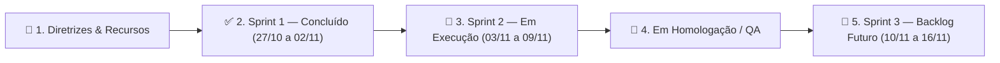

# QUADRO TRELLO OFICIAL DA EQUIPE — GESTÃO ÁGIL (SCRUM / KANBAN)
**Projeto:** Portal Integrado dos Estudantes da FATEC Rio Claro  
**Disciplina:** Estágio Curricular Supervisionado (Prof. Orlando)  
**Gestor de Qualidade, Requisitos & Agile Master:** Guilherme (DevOps, IA & QA)  
**Integrantes da Equipe (200h cada / 3 Sprints):**
* 👨‍💻 **Cesar** — Arquitetura Backend, Banco de Dados PostgreSQL & Segurança da Informação
* 🎨 **Luis** — Engenharia Frontend, UI/UX Design Simbiótico (IA/ESG), Acessibilidade & PWA
* 🤖 **Guilherme** — Infraestrutura DevOps (Vercel/Supabase), Inteligência Artificial (Google Gemini SDK), QA & Engenharia de Requisitos

---

## 1. ESTRUTURA DE ETIQUETAS (LABELS DO TRELLO)

| Cor da Etiqueta | Nome da Etiqueta | Escopo / Responsável Principal |
| :--- | :--- | :--- |
| 🔵 **Azul Escuro** | `[BACKEND & DB]` | APIs REST, PostgreSQL, Modelagem DER e Migrations (**Cesar**) |
| 🔴 **Vermelho** | `[SEGURANÇA OWASP]` | Bcrypt, JWT HttpOnly, RBAC, Rate Limiting e Auditoria (**Cesar**) |
| 🟢 **Verde Esmeralda** | `[FRONTEND & UI/UX]` | Design System Eco-Tech, Zero CLS, Acessibilidade e PWA (**Luis**) |
| 🟣 **Roxo** | `[IA & GEMINI SDK]` | Integração Google Gemini, OCR de Comprovantes Pix e Resumos (**Guilherme**) |
| 🟠 **Laranja** | `[DEVOPS & CLOUD]` | Hospedagem Vercel, Supabase Cloud, `.env` e CI/CD GitHub Actions (**Guilherme**) |
| 🟡 **Amarelo** | `[QA & REQUISITOS]` | Vitest, Playwright E2E, Especificação ERS e Gestão Trello (**Guilherme**) |

---

## 2. VISÃO PANORÂMICA DO KANBAN (RAIAS DO QUADRO TRELLO)

---

## 3. DETALHAMENTO DOS CARTÕES POR COLUNA (LISTAS DO TRELLO)

### 📌 COLUNA 1: DIRETRIZES DO PROJETO & DOCUMENTAÇÃO BASE
* **Card #00 — Visão do Produto & Pesquisa com 38 Alunos (IA + ESG)**
  * **Membros:** `@cesar`, `@luis`, `@guilherme`
  * **Descrição:** Centralizar resultados do formulário discente (38 respostas), unindo as turmas de IA (Matutino) e Gestão ESG (Noturno).
  * **Anexos Vinculados:** [`docs/especificacao_requisitos.md`](file:///c:/Users/guilh/Documents/GitHub/Estagio-Fatec/docs/especificacao_requisitos.md), [`database/der.md`](file:///c:/Users/guilh/Documents/GitHub/Estagio-Fatec/database/der.md), [`docs/arquitetura_seguranca.md`](file:///c:/Users/guilh/Documents/GitHub/Estagio-Fatec/docs/arquitetura_seguranca.md) e [`docs/devops_vercel_supabase.md`](file:///c:/Users/guilh/Documents/GitHub/Estagio-Fatec/docs/devops_vercel_supabase.md).

---

### ✅ COLUNA 2: SPRINT 1 — CONCLUÍDO (27/10 A 02/11/2026 — 66H POR INTEGRANTE)

#### 🔹 Entregas de DevOps, IA & QA — **Guilherme (66h)**
* **Card #G1 — Configurar Ambiente de Hospedagem e Variáveis na Vercel e Supabase** `[DEVOPS & CLOUD]` `(16h)`
  * **Responsável:** `@guilherme` | **Status:** ✅ Concluído
  * **Checklist:**
    - [x] Mapear e padronizar variáveis de ambiente em [`.env.example`](file:///c:/Users/guilh/Documents/GitHub/Estagio-Fatec/.env.example) (`DATABASE_URL`, `DIRECT_URL`, chaves Supabase, `JWT_SECRET` e `GEMINI_API_KEY`).
    - [x] Configurar [`vercel.json`](file:///c:/Users/guilh/Documents/GitHub/Estagio-Fatec/vercel.json) na região `gru1` (São Paulo) com headers OWASP e timeouts para Serverless Functions.
    - [x] Estruturar pipeline CI/CD no GitHub Actions ([`.github/workflows/ci-cd.yml`](file:///c:/Users/guilh/Documents/GitHub/Estagio-Fatec/.github/workflows/ci-cd.yml)).
    - [x] Documentar guia de deploy e Connection Pooling (Supavisor) em [`docs/devops_vercel_supabase.md`](file:///c:/Users/guilh/Documents/GitHub/Estagio-Fatec/docs/devops_vercel_supabase.md).

* **Card #G2 — Configurar Chaves de API e Testar Conectividade com o SDK do Google Gemini** `[IA & GEMINI SDK]` `(18h)`
  * **Responsável:** `@guilherme` | **Status:** ✅ Concluído
  * **Checklist:**
    - [x] Implementar serviço [`src/lib/gemini.ts`](file:///c:/Users/guilh/Documents/GitHub/Estagio-Fatec/src/lib/gemini.ts) integrado ao SDK `@google/genai` (`gemini-2.5-flash`) com fallback resiliente para QA.
    - [x] Criar função de validação OCR de comprovantes Pix (`validatePixReceiptWithGemini`) extraindo valor monetário e ID End-to-End.
    - [x] Construir endpoint de diagnóstico `GET/POST /api/ai/status` ([`src/app/api/ai/status/route.ts`](file:///c:/Users/guilh/Documents/GitHub/Estagio-Fatec/src/app/api/ai/status/route.ts)).
    - [x] Criar e validar script CLI [`scripts/test_gemini.js`](file:///c:/Users/guilh/Documents/GitHub/Estagio-Fatec/scripts/test_gemini.js) (`npm run test:gemini`).

* **Card #G3 — Definir a Esteira de Testes Automatizados (Vitest / Playwright)** `[QA & REQUISITOS]` `(16h)`
  * **Responsável:** `@guilherme` | **Status:** ✅ Concluído
  * **Checklist:**
    - [x] Configurar **Vitest** ([`vitest.config.ts`](file:///c:/Users/guilh/Documents/GitHub/Estagio-Fatec/vitest.config.ts)) para testes unitários e de integração.
    - [x] Configurar **Playwright** ([`playwright.config.ts`](file:///c:/Users/guilh/Documents/GitHub/Estagio-Fatec/playwright.config.ts)) para testes E2E Desktop e Mobile PWA.
    - [x] Implementar suítes em `tests/unit/` (`security.test.ts`, `gemini.test.ts`, `db_rbac.test.ts`) e `tests/e2e/portal.spec.ts`.
    - [x] Criar orquestrador unificado [`scripts/run_all_tests.js`](file:///c:/Users/guilh/Documents/GitHub/Estagio-Fatec/scripts/run_all_tests.js) (`npm test` com 100% de aprovação).

* **Card #G4 — Elaborar Documento de Especificação de Requisitos e Quadro Trello da Equipe** `[QA & REQUISITOS]` `(16h)`
  * **Responsável:** `@guilherme` | **Status:** ✅ Concluído
  * **Checklist:**
    - [x] Redigir Especificação de Requisitos (ERS / IEEE 830) em [`docs/especificacao_requisitos.md`](file:///c:/Users/guilh/Documents/GitHub/Estagio-Fatec/docs/especificacao_requisitos.md) (RF-01 a RF-18, RNF-01 a RNF-12 e Matriz de Rastreabilidade).
    - [x] Estruturar Quadro Trello oficial da equipe em [`docs/quadro_trello_equipe.md`](file:///c:/Users/guilh/Documents/GitHub/Estagio-Fatec/docs/quadro_trello_equipe.md).
    - [x] Consolidar Relatório Individual da Sprint 1 em [`docs/relatorio_estagio_sprint1_guilherme.md`](file:///c:/Users/guilh/Documents/GitHub/Estagio-Fatec/docs/relatorio_estagio_sprint1_guilherme.md).

---

#### 🔹 Entregas de Backend, Banco de Dados & Segurança — **Cesar (66h)**
* **Card #C1 — Modelagem Relacional (DER) e DDL PostgreSQL (8 Tabelas)** `[BACKEND & DB]` `(28h)` — ✅ Concluído (`database/der.md`, `database/schema.sql`, `database/seed.sql`)
* **Card #C2 — Motor de Autenticação Bcrypt, JWT (`jose`) e RBAC Middleware** `[SEGURANÇA OWASP]` `(24h)` — ✅ Concluído (`src/lib/auth.ts`, `src/lib/security.ts`, `src/middleware.ts`)
* **Card #C3 — Endpoints REST de Autenticação, Health Check e Testes de Segurança** `[BACKEND & DB]` `(14h)` — ✅ Concluído (`src/app/api/auth/*`, `src/app/api/health/route.ts`, `scripts/test_backend.js`)

---

#### 🔹 Entregas de Frontend, UI/UX, Acessibilidade & PWA — **Luis (66h)**
* **Card #L1 — Pesquisa de UX, Identidade Visual FATEC/CPS e Mascote Galo Widget** `[FRONTEND & UI/UX]` `(22h)` — ✅ Concluído (`src/components/brand/*`, `public/brand/*`)
* **Card #L2 — Design System Simbiótico (IA/ESG), Fundo Toroidal Canvas e Zero CLS** `[FRONTEND & UI/UX]` `(20h)` — ✅ Concluído (`src/app/globals.css`, `src/components/layout/EcoTechBackground.tsx`, `src/app/page.tsx`)
* **Card #L3 — Layout Multiplataforma PWA, Login, Cadastro e Rotas Acadêmicas** `[FRONTEND & UI/UX]` `(24h)` — ✅ Concluído (`src/components/layout/AppLayout.tsx`, `src/app/login/page.tsx`, `src/app/cadastro/page.tsx`, `public/manifest.json`)

---

### 🚀 COLUNA 3: SPRINT 2 — EM PLANEJAMENTO / EXECUÇÃO (03/11 A 09/11/2026 — 67H POR INTEGRANTE)

* **Card #S2-G1 (Guilherme — IA & QA):** Upload Multimodal de Imagem de Comprovante Pix (Base64/Storage Supabase) para o OCR do Google Gemini e Painel de Auditoria do CA.
* **Card #S2-G2 (Guilherme — QA):** Testes Automatizados de Carga e E2E do Fluxo Completo de Compra na Cantina Discente.
* **Card #S2-C1 (Cesar — Backend):** Endpoints REST de Catálogo da Cantina (`/api/canteen/products`), Checkout Pix EMV (`/api/canteen/checkout`) e Baixa Automática de Estoque.
* **Card #S2-C2 (Cesar — Backend):** Endpoints REST de Repositório Acadêmico (`/api/materials`) e Mural de Avisos (`/api/announcements`).
* **Card #S2-L1 (Luis — Frontend):** Integração Dinâmica da Tela da Cantina (`/cantina`) com Carrinho Interativo, QR Code Pix em Tempo Real e Upload de Comprovante.
* **Card #S2-L2 (Luis — Frontend):** Filtros Dinâmicos no Repositório Acadêmico (`/repositorio`) por Semestre (1º ao 4º) e Curso (`IA` / `ESG`).

---

### 🎯 COLUNA 4: SPRINT 3 — BACKLOG FUTURO (10/11 A 16/11/2026 — 67H POR INTEGRANTE)

* **Card #S3-G1 (Guilherme — IA & DevOps):** Assistente Acadêmico Conversacional Gemini no Repositório Didático + Monitoramento de Métricas em Produção na Vercel.
* **Card #S3-C1 (Cesar — Backend & Segurança):** Exportação de Relatórios Financeiros da Cantina para o Centro Acadêmico e Auditoria Avançada de Segurança (Pentest OWASP ZAP).
* **Card #S3-L1 (Luis — Frontend & PWA):** Service Workers para Cache Offline de Notas de Aula no PWA, Vitrine Interativa de TCCs (`/vitrine`) e Homologação Final com Leitores de Tela (NVDA).
